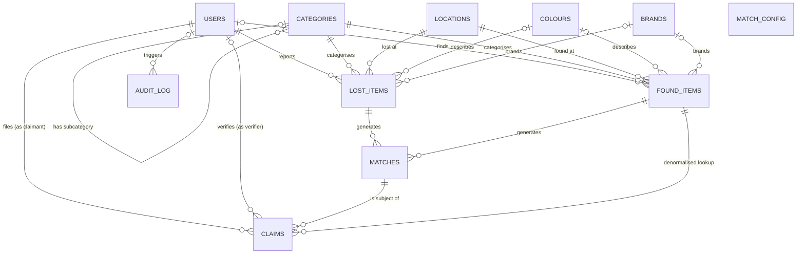

# FoundIt Conceptual ER Diagram

## Conceptual Notes

1. **audit_log Polymorphic Link**: The `audit_log` table connects to the entity it records via a polymorphic link (`entity_type` + `entity_id`). Because this link spans multiple tables (users, claims, items), it carries no foreign key constraint. This is a deliberate trade-off in the schema to keep audit events in a single table, so only the `USERS` relationship (for `changed_by`) is drawn above.
2. **score_bands Derivation**: The `matches` relation derives its `match_band` from `score_bands` via a range join (where `match_score` is BETWEEN `lower_bound` AND `upper_bound`). There is no explicit foreign key connecting them, so the line is omitted from the diagram.
# FoundIt Database Analysis

## 1. Entity Inventory (T1.2)

- **users**: Responsible for system participants (students, staff, admins). Exists as its own relation to prevent redundant storage of user contact details and credentials across claims and item reports.
- **locations**: Responsible for tracking distinct physical places on campus. Exists as its own relation to prevent update anomalies and inconsistency in location string entry.
- **categories**: Responsible for the hierarchical taxonomy of items. Exists as its own relation because it holds properties like `requires_staff` and `is_sensitive` independently of the items themselves.
- **colours**: Responsible for a standardised colour palette. Exists as its own relation to ensure consistent selection and avoid free-text anomalies.
- **brands**: Responsible for recognised manufacturers/brands. Exists as its own relation for the same standardisation and indexing reasons as colours.
- **score_bands**: Responsible for match score-to-band mappings. Exists as its own relation to store grading thresholds as data rather than hard-coded application logic.
- **lost_items**: Responsible for tracking items reported missing. Exists as a separate entity from found items because their lifecycles, mandatory fields, and state machines differ fundamentally.
- **found_items**: Responsible for tracking items discovered and handed in. Exists as a separate entity due to its strict chain-of-custody rules and the possibility of anonymous finders.
- **matches**: Responsible for algorithmic similarity links between a lost and found item. Exists as its own relation because it resolves a many-to-many relationship with its own derived scoring attributes.
- **claims**: Responsible for the workflow of a user asserting ownership over a matched item. Exists as its own relation because a claim has a complex, independent state machine and audit trail.
- **audit_log**: Responsible for the immutable history of state changes across the system. Exists as its own relation to avoid a repeating group (1NF violation) inside the primary entities.
- **match_config**: Responsible for engine configuration variables and weights. Exists as its own relation so that algorithmic tuning requires no schema migrations or code deployments.

## 2. Functional Dependency Analysis (T1.4)

### users
*Attributes*: {user_id, full_name, email, password_hash, phone, department, role, is_active, flagged_count, created_at, updated_at}
*Non-trivial FDs*:
- FD1: user_id → {all other attributes}
- FD2: email → {all other attributes}
*Closure Computation*:
- `{user_id}+`
  - Step 0: `{user_id}`
  - Step 1: apply FD1 → adds all other attributes
  - Step 2: no further FDs apply; closure is stable.
  - Result: closure = R, therefore `{user_id}` is a superkey.
  - Minimality: `{user_id}` is a single attribute, so no proper non-empty subset exists. Therefore it is a candidate key.
- `{email}+`
  - Step 0: `{email}`
  - Step 1: apply FD2 → adds all other attributes
  - Step 2: closure is stable.
  - Result: closure = R, superkey.
  - Minimality: `{email}` is a single attribute. Therefore it is a candidate key.
*Prime Attributes*: user_id, email

### locations
*Attributes*: {location_id, location_name, building, floor, zone, is_active, created_at}
*Non-trivial FDs*:
- FD1: location_id → {all other attributes}
- FD2: (location_name, building) → location_id, floor, zone, is_active, created_at
- FD3: building → zone (transitive dependency)
*Closure Computation*:
- `{location_id}+`
  - Step 0: `{location_id}`
  - Step 1: apply FD1 → adds all other attributes
  - Step 2: stable. Result: closure = R, superkey.
  - Minimality: single attribute. Candidate key.
- `{location_name, building}+`
  - Step 0: `{location_name, building}`
  - Step 1: apply FD2 → adds location_id, floor, zone, is_active, created_at
  - Step 2: stable. Result: closure = R, superkey.
  - Minimality: `{location_name}+` = `{location_name}`, not a superkey. `{building}+` = `{building, zone}`, not a superkey. Therefore `{location_name, building}` is a candidate key.
*Prime Attributes*: location_id, location_name, building

### categories
*Attributes*: {category_id, category_name, parent_id, requires_staff, is_sensitive, is_active}
*Non-trivial FDs*:
- FD1: category_id → {all other attributes}
- FD2: category_name → {all other attributes}
*Closure Computation*:
- `{category_id}+`
  - Step 0: `{category_id}`
  - Step 1: apply FD1 → adds all other attributes. Stable.
  - Result: closure = R. Candidate key (single attribute).
- `{category_name}+`
  - Step 0: `{category_name}`
  - Step 1: apply FD2 → adds all other attributes. Stable.
  - Result: closure = R. Candidate key (single attribute).
*Prime Attributes*: category_id, category_name

### colours
*Attributes*: {colour_id, colour_name, hex_value, is_active}
*Non-trivial FDs*:
- FD1: colour_id → {all other attributes}
- FD2: colour_name → {all other attributes}
*Closure Computation*:
- `{colour_id}+`
  - Step 0: `{colour_id}`
  - Step 1: apply FD1 → adds all other attributes. Stable.
  - Result: closure = R. Candidate key (single attribute).
- `{colour_name}+`
  - Step 0: `{colour_name}`
  - Step 1: apply FD2 → adds all other attributes. Stable.
  - Result: closure = R. Candidate key (single attribute).
*Prime Attributes*: colour_id, colour_name

### brands
*Attributes*: {brand_id, brand_name, is_active}
*Non-trivial FDs*:
- FD1: brand_id → {all other attributes}
- FD2: brand_name → {all other attributes}
*Closure Computation*:
- `{brand_id}+`
  - Step 0: `{brand_id}`
  - Step 1: apply FD1 → adds all other attributes. Stable.
  - Result: closure = R. Candidate key (single attribute).
- `{brand_name}+`
  - Step 0: `{brand_name}`
  - Step 1: apply FD2 → adds all other attributes. Stable.
  - Result: closure = R. Candidate key (single attribute).
*Prime Attributes*: brand_id, brand_name

### score_bands
*Attributes*: {band_name, lower_bound, upper_bound}
*Non-trivial FDs*:
- FD1: band_name → lower_bound, upper_bound
*Closure Computation*:
- `{band_name}+`
  - Step 0: `{band_name}`
  - Step 1: apply FD1 → adds lower_bound, upper_bound. Stable.
  - Result: closure = R. Candidate key (single attribute).
*Prime Attributes*: band_name

### lost_items
*Attributes*: {lost_id, user_id, item_name, category_id, location_id, colour_id, brand_id, brand_other, description, lost_date, lost_time_from, lost_time_to, status, resolved_at, created_at, updated_at, search_vector}
*Non-trivial FDs*:
- FD1: lost_id → {all other attributes}
- FD2: (item_name, description) → search_vector
*Closure Computation*:
- `{lost_id}+`
  - Step 0: `{lost_id}`
  - Step 1: apply FD1 → adds all other attributes. Stable.
  - Result: closure = R. Candidate key (single attribute).
*Prime Attributes*: lost_id

### found_items
*Attributes*: {found_id, user_id, item_name, category_id, location_id, colour_id, brand_id, brand_other, description, private_feature, found_date, found_time, custody, storage_location, finder_note, status, is_high_value, returned_at, created_at, updated_at, search_vector}
*Non-trivial FDs*:
- FD1: found_id → {all other attributes}
- FD2: (item_name, description) → search_vector
*Closure Computation*:
- `{found_id}+`
  - Step 0: `{found_id}`
  - Step 1: apply FD1 → adds all other attributes. Stable.
  - Result: closure = R. Candidate key (single attribute).
*Prime Attributes*: found_id

### matches
*Attributes*: {match_id, lost_id, found_id, match_score, match_band, reason_json, status, created_at, updated_at}
*Non-trivial FDs*:
- FD1: match_id → {all other attributes}
- FD2: (lost_id, found_id) → {all other attributes}
- FD3: match_score → match_band
*Closure Computation*:
- `{match_id}+`
  - Step 0: `{match_id}`
  - Step 1: apply FD1 → adds all other attributes. Stable.
  - Result: closure = R. Candidate key (single attribute).
- `{lost_id, found_id}+`
  - Step 0: `{lost_id, found_id}`
  - Step 1: apply FD2 → adds match_id, match_score, match_band, reason_json, status, created_at, updated_at
  - Step 2: apply FD3 → match_band already present. Stable.
  - Result: closure = R, superkey.
  - Minimality: `{lost_id}+` = `{lost_id}`. `{found_id}+` = `{found_id}`. Neither proper subset is a superkey, therefore candidate key.
*Prime Attributes*: match_id, lost_id, found_id

### claims
*Attributes*: {claim_id, match_id, claimant_id, proof_text, status, verifier_id, decision_note, claimed_at, decided_at, completed_at, found_id}
*Non-trivial FDs*:
- FD1: claim_id → {all other attributes}
- FD2: match_id → found_id
*Closure Computation*:
- `{claim_id}+`
  - Step 0: `{claim_id}`
  - Step 1: apply FD1 → adds all other attributes. Stable.
  - Result: closure = R. Candidate key (single attribute).
*(Note: {match_id, claimant_id} is not a candidate key because a user can file multiple sequential claims for the same match if an earlier one was rejected).*
*Prime Attributes*: claim_id

### match_config
*Attributes*: {config_key, config_value, description, version, updated_at}
*Non-trivial FDs*:
- FD1: config_key → {all other attributes}
*Closure Computation*:
- `{config_key}+`
  - Step 0: `{config_key}`
  - Step 1: apply FD1 → adds all other attributes. Stable.
  - Result: closure = R. Candidate key (single attribute).
*Prime Attributes*: config_key

### audit_log
*Attributes*: {audit_id, entity_type, entity_id, action, old_status, new_status, changed_by, detail, changed_at}
*Non-trivial FDs*:
- FD1: audit_id → {all other attributes}
*Closure Computation*:
- `{audit_id}+`
  - Step 0: `{audit_id}`
  - Step 1: apply FD1 → adds all other attributes. Stable.
  - Result: closure = R. Candidate key (single attribute).
*(Note: The tuple (entity_type, entity_id, changed_at) appears to be a candidate key but is not. NOW() is transaction-stable in PostgreSQL, so multiple audit rows written in a single transaction (e.g., claim approval) will share identical `changed_at` values. This requires the surrogate key `audit_id` to maintain ordering and uniqueness).*
*Prime Attributes*: audit_id

## 3. Decomposition Narrative (T1.5)

### The Unnormalised Starting Point
We begin with the naive design:
`REPORT_RAW(report_id, reporter_name, reporter_email, reporter_phone, reporter_dept, item_name, category_name, colour_name, brand_name, description, location_name, building, floor, event_date, status, status_history)`

### First Normal Form (1NF)
`status_history` holds a sequence of transitions in a single string (e.g., "OPEN → MATCHED → CLAIMED"). This is a repeating group and is not atomic.
**Remedy**: Extract the history into a separate relation with one row per transition, which becomes `audit_log`.

### Second Normal Form (2NF)
There is no 2NF violation in this schema. Every relation possesses a single-attribute primary key, meaning partial dependencies are impossible by construction.

To demonstrate where a 2NF violation would arise, consider a hypothetical `MATCH_COMPONENT` relation:
`MATCH_COMPONENT(lost_id, found_id, component_code, points, lost_item_name)`
The key is `{lost_id, found_id, component_code}`. However, `lost_item_name` depends on `lost_id` alone — a proper subset of the key. This is a partial dependency (a 2NF violation), remedied by removing `lost_item_name` and joining to `lost_items`.

### Third Normal Form (3NF)
Four transitive dependencies are present where a non-prime attribute determines other non-prime attributes:
1. `report_id → reporter_email → reporter_name, reporter_phone, reporter_dept`
2. `report_id → location_name  → building, floor`
3. `report_id → category_name  → (category attributes)`
4. `report_id → brand_name     → (brand attributes)`

**Anomalies** (using location as the example):
- **Update Anomaly**: If a building is renamed, four hundred rows must change together; if it fails halfway, the data is inconsistent.
- **Insertion Anomaly**: A new building opens, but there is nowhere to record it until something is lost there.
- **Deletion Anomaly**: The last report at a location is withdrawn, and the fact that the location exists is erased with it.

**Remedy**: Decompose each dependency into a reference relation plus a foreign key, producing `users`, `locations`, `categories`, and `brands`.

## 4. Deliberate Denormalisations & Summary

The schema design introduces five deliberate redundancies: four guarded transitive dependencies (D1, D2, D4, D5) which are genuine 3NF violations within their relations, and one cross-relation derived attribute (D3) which is not a normal-form violation but carries its own anomaly risk.

- **D1. matches.match_band**: Materialised from `score_bands`. Justification: Band is filtered/grouped in nearly every match query, and range joins are wasteful on every read. **Guard: `ck_match_band_consistent`** (plus matching procedure as the only writer).
- **D2. locations.zone**: Dependent on building. Justification: Building count is under twenty, and a separate `buildings` relation would add a join for negligible benefit. **Guard: Seed data is the sole writer**. Revisit if building count exceeds forty.
- **D3. users.flagged_count**: Running counter rather than computed aggregate. Justification: Avoids a correlated aggregate query on every user display. **Guard: Reconciliation query** comparing counter to the aggregate. Because the risk is not a transitive dependency but divergence between a stored counter and the aggregate it summarises, its guard cannot be a constraint — no constraint can see across relations to verify a count. That is why D3's guard is a periodic reconciliation query rather than a CHECK constraint.
- **D4. claims.found_id**: Functionally determined by the referenced match row (`match_id → found_id`). Both non-prime. Transitive dependency. Justification: Not for read performance, but to make a business rule expressible as a declarative partial unique index (`ux_one_approved_claim_per_found`). This spends normal form to buy integrity. **Guard: `trg_claims_denormalise_found`**.
- **D5. *_items.search_vector**: Determined by `{item_name, description}`. Transitive dependency. Justification: Caching full text search vectors. **Guard: `GENERATED ALWAYS`** (Computed by the storage engine, physical prevention of application modification; cannot drift at all).

### Summary Table

| Relation | 1NF | 2NF | 3NF | BCNF | Notes |
| :--- | :--- | :--- | :--- | :--- | :--- |
| users | Yes | Yes | Yes | Yes | `flagged_count` denormalised (D3) |
| locations | Yes | Yes | No | No | `building → zone` accepted (D2) |
| categories | Yes | Yes | Yes | Yes | |
| colours | Yes | Yes | Yes | Yes | |
| brands | Yes | Yes | Yes | Yes | |
| score_bands | Yes | Yes | Yes | Yes | |
| lost_items | Yes | Yes | No | No | `search_vector` generated (D5) |
| found_items | Yes | Yes | No | No | `search_vector` generated (D5) |
| matches | Yes | Yes | No | No | `match_band` materialised (D1) |
| claims | Yes | Yes | No | No | `found_id` materialised (D4) |
| audit_log | Yes | Yes | Yes | Yes | |
| match_config | Yes | Yes | Yes | Yes | |

## 5. Data Dictionary

## 6. Referential Integrity Policy

Every foreign key declares an explicit `ON DELETE` and `ON UPDATE` action, chosen by asking a single question: if the parent row disappeared, would the child row still mean anything?

| Child → Parent | ON DELETE | Reasoning |
| :--- | :--- | :--- |
| `lost_items` → `users` | RESTRICT | A report without a reporter is meaningless and its audit trail would dangle. |
| `found_items` → `users` | SET NULL | Anonymous finds are legitimate, so a null finder is a valid state the schema already allows. |
| `lost_items` → `categories` | RESTRICT | Reference data in use must not vanish; deactivate instead. |
| `lost_items` → `locations` | RESTRICT | Same. |
| `lost_items` → `colours` | SET NULL | Colour is optional; losing it degrades matching slightly and breaks nothing. |
| `lost_items` → `brands` | SET NULL | Same. |
| `matches` → `lost_items` | CASCADE | A match is derived data with no independent meaning. |
| `matches` → `found_items` | CASCADE | Same. |
| `claims` → `matches` | RESTRICT | A claim is a record of a human assertion and must survive. |
| `claims` → `users` (claimant) | RESTRICT | Accountability requires the claimant to remain identifiable. |
| `claims` → `users` (verifier) | SET NULL | The decision stands even if the verifier's account is removed. |
| `audit_log` → `users` | SET NULL | History outlives accounts. |
| `categories` → `categories` | RESTRICT | Prevents orphaned subtrees. |

**ON UPDATE is CASCADE everywhere.** With surrogate integer keys this action should never fire, and declaring it costs nothing while protecting against a future key-renumbering migration.
